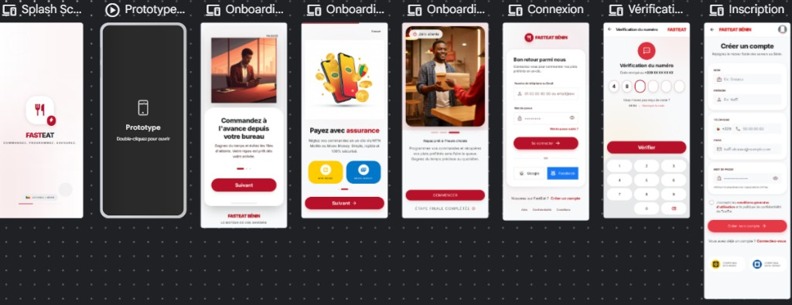
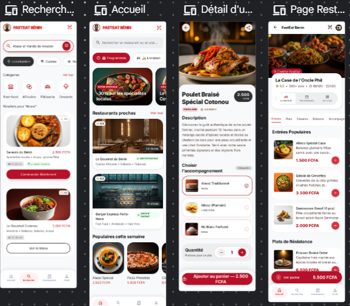
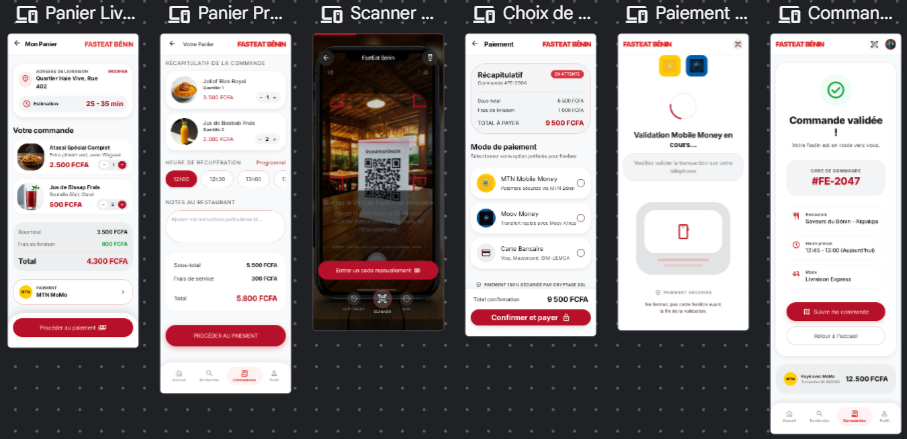
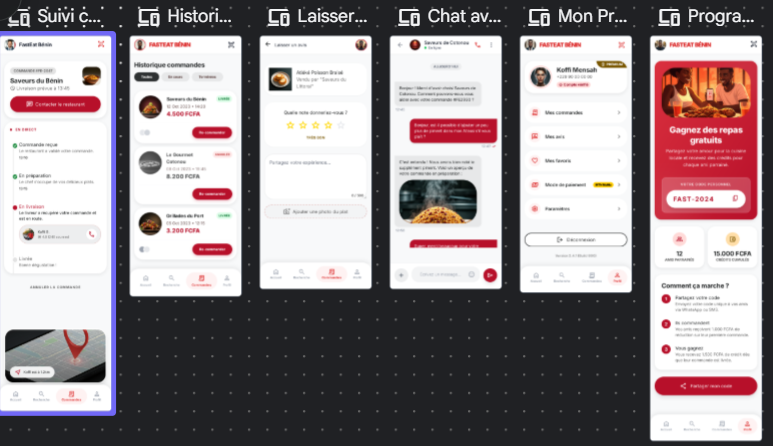

# FastEat Benin 🇧🇯 — Application Client


**FastEat** est une application mobile Flutter moderne et intuitive qui permet aux utilisateurs de commander de délicieux repas auprès des meilleurs restaurants partenaires au Bénin. Notre mission est de simplifier la livraison de nourriture avec une expérience utilisateur exceptionnelle et un paiement transparent via Mobile Money.

Le **back-office restaurant** est géré dans un projet séparé : [`fasteat_dashboard`](../fasteat_dashboard).

## 📱 Aperçu de l'Application

Voici quelques écrans principaux de notre application :

<p align="center">
  
  
  
  
</p>

## ✨ Fonctionnalités Principales

- **Onboarding & Authentification** : Une expérience d'intégration fluide pour les nouveaux utilisateurs, avec gestion de session sécurisée (JWT).
- **Exploration des Restaurants & Plats** : Parcourez les restaurants, consultez les menus, et explorez les détails de chaque plat.
- **Gestion du Panier** : Ajoutez, modifiez et visualisez facilement les éléments de votre commande avant le passage en caisse.
- **Paiement Mobile Money** : Intégration transparente pour les paiements locaux au Bénin.
- **Suivi des Commandes** : Suivez le statut de vos commandes en temps réel.
- **Favoris** : Gardez vos restaurants préférés à portée de main grâce à une synchronisation en ligne.
- **Notifications** : Restez informé des mises à jour de vos commandes et des promotions.

## 🚀 Lancer le projet

### Prérequis
- Flutter SDK (dernière version stable recommandée)
- Dart SDK
- Émulateur Android/iOS ou appareil physique

### Instructions

```bash
# Accéder au dossier (si applicable)
cd fasteat

# Installer les dépendances
flutter pub get

# Lancer l'application
flutter run
```

## 🛠 Architecture

L'application est structurée de manière modulaire pour garantir sa scalabilité :

| Dossier | Rôle |
|---------|------|
| `lib/data/api/` | Services HTTP (auth, restaurants, panier, commandes, paiements, favoris, notifications) |
| `lib/providers/` | Gestion de l'état global avec Provider |
| `lib/screens/` | Écrans de l'interface utilisateur |
| `lib/widgets/` | Composants UI réutilisables |
| `lib/data/mock/` | Données de secours pour un fonctionnement hors ligne / mode démo |

## 🔗 Liens & API

- **Base de l'API** : `https://fast-eat-npb7.onrender.com/api/v1`
- **Configuration** : `lib/data/api/api_config.dart`
- **Projet Dashboard (Restaurant)** : `fasteat_dashboard`

---
*Conçu avec ❤️ pour une meilleure expérience de livraison au Bénin.*
